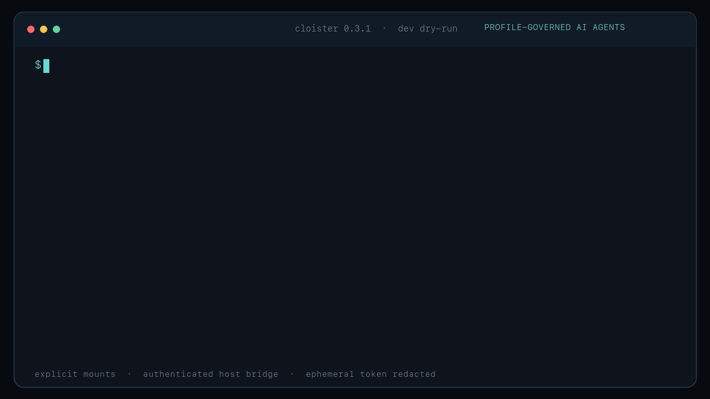

# Cloister

[](https://github.com/yi427/Cloister/actions/workflows/verify.yml)
[](https://github.com/yi427/Cloister/actions/workflows/publish-image.yml)
[](#license)

Cloister runs Codex and Claude Code inside profile-governed Apple container
environments on Apple silicon Macs. Workspace mounts, agent state, resources,
networking, proxy behavior, guest images, and optional host commands remain
explicit and reviewable.



> [!IMPORTANT]
> Cloister currently supports Apple silicon Macs with Apple `container` 1.2 or
> newer. It is pre-1.0 software, so Profile compatibility and security-boundary
> changes may still require deliberate updates between releases.

## Why Cloister

AI coding agents are useful precisely because they can inspect files, run
tools, and modify projects. Cloister keeps that workflow while making its
authority inspectable:

- only the selected project is mounted as the workspace by default;
- host credential directories and privileged sockets are never mounted
  silently;
- CPU, memory, locale, timezone, user, image, network, and proxy choices come
  from a versioned Profile;
- optional macOS commands pass through an authenticated bridge with an explicit
  allowlist or on-demand policy; and
- dry-run plans, readiness checks, and audit metadata expose the
  active boundaries without printing secrets.

> [!NOTE]
> [0.4.0](https://github.com/yi427/Cloister/releases/tag/v0.4.0) adds explicit
> on-demand Host tools in Profile V8. Existing V7 Profiles keep allowlist
> behavior and can update their image with `cloister profile upgrade`.
> See the [release notes](docs/releases/v0.4.0.md).

## Quick start

### Requirements

- Apple silicon Mac
- Apple `container` 1.2 or newer
- a Linux ARM64 Cloister image matching the CLI release

Install Apple's signed package from the
[`container` releases page](https://github.com/apple/container/releases), or
allow Homebrew to install it as a dependency in the next step.

### Install

Released Cloister versions are available from the official Homebrew tap. The Formula builds
Cloister from immutable release source. It does not start the runtime, create a
Profile, or pull the guest image.

```sh
brew install yi427/tap/cloister
```

Create the default Profile and prepare missing Apple container components:

```sh
cloister init
```

`init` shows and confirms each mutation separately. It can start Apple
`container`, pull the exact release image, and create the required localhost
DNS mapping. Existing files, directories, and symbolic links at the Profile
path are never overwritten.

Check configuration and runtime readiness, then launch an agent in a project:

```sh
cloister check

cd /path/to/project
cloister codex
# or: cloister claude
```

The directory is mounted at its canonical host path
under `/workspace`; for example, `/Volumes/Projects/app` becomes
`/workspace/Volumes/Projects/app`.
The agent starts in that project directory. Select another directory for one
invocation with `--workspace`.

### Install from the exact Git tag

Direct source installation requires Rust 1.97.1 or newer with Cargo:

```sh
cargo install --locked \
  --git https://github.com/yi427/Cloister.git \
  --tag v0.4.0 \
  cloister
```

### Upgrade

Profile V6 and earlier require a new V8 Profile; `profile upgrade` does not
migrate schemas. Supported V7 and V8 Profiles pair the CLI tag and base image:

```text
CLI:   v0.4.0
Image: ghcr.io/yi427/cloister:0.4.0
```

Cloister refuses to start an agent when an official release image does not
exactly match the CLI version. After upgrading the CLI, preview and apply the
corresponding Profile update explicitly:

```sh
cloister profile upgrade --dry-run
cloister profile upgrade
cloister check
```

The upgrade command verifies the replacement Linux ARM64 image before asking
to back up and atomically update the Profile. It never rewrites a Profile or
pulls an image during `--dry-run`.

## Security boundaries at a glance

| Boundary | Cloister behavior |
| --- | --- |
| Guest root filesystem | Read-only, with an ephemeral container removed after the agent exits. |
| Workspace | One explicitly selected host directory mounted live at its canonical path under `/workspace` as read-write. |
| Agent credentials and state | Existing host `~/.codex` and `~/.claude` directories are never mounted; shared state uses separate Cloister-managed directories. |
| Network | Apple container's default network may reach the internet; it is not an egress firewall. |
| Host commands | Available only when enabled by the Profile, through an authenticated bridge; the Profile selects a fixed allowlist or broad on-demand host PATH access, with the invoking macOS user's permissions. |
| Observability | Dry-run plans, readiness checks, and bounded audit metadata expose active policy without persisting secrets or command output. |

## Security model

Cloister reduces ambient host access; it is not a complete sandbox for every
capability it exposes.

Cloister 0.4.0 adds Profile V8 and explicit on-demand Host tools.
V7 Profiles keep their existing allowlist behavior. Enabling on-demand
requires V8 and the matching 0.4.0 guest image, which includes the updated
canonical Host Skill.

> [!WARNING]
> The workspace is a live read-write bind mount. An agent can modify or delete
> files in the selected project.

> [!WARNING]
> Host Exec is an explicit escape hatch from the guest boundary. An allowed
> command runs as the macOS user who started Cloister. Interpreters and build
> tools such as `python`, `cargo`, and `xcodebuild` may provide broad host code
> execution even when only their executable names are allowlisted. On-demand
> mode explicitly grants broad access to host PATH programs. Guest-first
> instructions and required purpose text guide Agent behavior; they do not
> contain filesystem or network access by host commands.

The following claims are intentionally narrow:

- host credential directories and privileged sockets are never mounted
  silently;
- Profile validation and mode-specific Host Exec checks fail closed;
- arguments are passed directly as an argument vector without shell parsing;
- the default Apple container network may reach the internet and is not an
  egress firewall;
- an agent approval prompt is an interaction policy, not a security boundary;
- a guest process that obtains the ephemeral bridge token can call enabled
  bridge tools directly, although every execution still passes server-side
  Profile validation; and
- Host Exec audit logs are observational, not tamper-proof, because an allowed
  host command may have enough macOS permission to alter them.

Read the accepted architecture decisions under [`docs/adr`](docs/adr) before
changing these boundaries.

## Architecture

```text
macOS host
├── Cloister CLI
│   ├── Profile loading and readiness checks
│   ├── Apple container command construction
│   └── authenticated loopback Host MCP bridge
│       └── Profile-allowed macOS commands
└── Apple container VM
    ├── /workspace/<host-path>     live read-write project mount
    ├── /cloister/agents/<agent>   optional Cloister-managed shared state
    ├── Codex or Claude Code
    └── canonical host-exec skill
```

The container is ephemeral and removed after the agent exits. The workspace
and optional shared agent state remain on the host.

## Profiles

Cloister uses a versioned TOML Profile as its public configuration contract.
The default path is:

```text
${XDG_CONFIG_HOME:-~/.config}/cloister/profile.toml
```

An abbreviated Profile V8 looks like this:

```toml
schema_version = 8
name = "default"

[image]
reference = "ghcr.io/yi427/cloister:0.4.0"
architecture = "arm64"

[guest]
cpus = 4
memory = "8G"
user = "cloister"
locale = "en_US.UTF-8"
timezone = "America/New_York"

[network]
mode = "default"
proxy = "disabled" # or "inherit"

[agent]
state = "shared" # or "isolated"
codex = "latest" # or an exact stable version such as "0.147.0"
claude = "latest" # or an exact stable version such as "2.1.227"
update_interval_hours = 24 # 0 checks on every launch

[host.exec]
enabled = true
mode = "allowlist" # or explicitly enable broad "on-demand" host access

[host.exec.environment]
mode = "inherit-all"

[[host.exec.allow]]
name = "xcodebuild"
executable = "/usr/bin/xcodebuild"
description = "Build and test Xcode projects"
arguments = "any"
```

The complete allowlist example is [`examples/profile.toml`](examples/profile.toml).
[`examples/profile-on-demand.toml`](examples/profile-on-demand.toml) shows the
new mode. V8 requires an explicit `host.exec.mode`. V7 remains supported with
allowlist behavior; V6 and earlier are rejected. No Profile is silently migrated.

### Agent state

`state = "shared"` preserves the selected agent's credentials, settings,
history, and sessions across projects. Codex and Claude use separate
Cloister-managed directories:

```text
${XDG_DATA_HOME:-~/.local/share}/cloister/agents/codex
${XDG_DATA_HOME:-~/.local/share}/cloister/agents/claude
```

These directories are owner-only and should be treated as secrets. Cloister
never substitutes the host's pre-existing agent configuration directories.
`state = "isolated"` keeps agent state inside the ephemeral container instead.

Cloister 0.3.1 gives each canonical host workspace a distinct, stable
guest working directory, including projects with the same directory name.
Repeated launches and symbolic links to the same host directory use the same
guest path. This lets agents apply
their normal project filtering to shared session history. Moving a project to a
different canonical host path changes its guest path.

For Codex, `cloister codex -- resume` uses the current project filter;
`cloister codex -- resume --all` explicitly shows sessions across projects.
Existing sessions recorded at the old `/workspace` path remain in shared state
and can be found with `resume --all`; Cloister does not rewrite their histories.

### Agent installation and updates

On first use, Cloister downloads only the selected Agent from the official npm
registry (`@openai/codex` or `@anthropic-ai/claude-code`). Software is stored
separately from login/configuration/session state:

```text
${XDG_DATA_HOME:-~/.local/share}/cloister/software/linux-arm64/<agent>/
```

A dedicated preparation container receives only a writable staging directory
and the Profile-selected proxy. It receives no workspace, Agent state, or Host
MCP token. npm verifies package integrity during installation; the helper runs
`--version` before committing an installation. npm diagnostics are suppressed
because they can contain proxy credentials. Failures report the phase without
printing package-manager output.

Cloister checks `latest` at the configured interval (24 hours by default),
serializes installation across processes, and atomically publishes a complete
version. Sessions mount only their selected installation, read-only. Updating
software does not replace files used by an existing session. Agent self-updates
are not the update authority; use Cloister's controls:

```sh
cloister codex --update-agent
cloister claude --update-agent
cloister codex --agent-version 0.147.0
cloister codex --offline
```

An exact version is reused without automatic updates. `--agent-version` applies
only to that invocation; editing the Profile pins it persistently. Older cached
versions can be selected this way for rollback. Installation caches are tied to
the selected base-image reference. Custom mutable image tags are not a content
identity; force a software check after rebuilding a custom image.

A failed automatic download/check warns and reuses an existing installation.
First installation, an unavailable exact version, or an explicit `--update-agent`
failure stops launch. Invalid metadata fails closed. `--offline` affects software
preparation only; it does **not** block the Agent's network access. It requires
an already-installed matching image/version. `--dry-run` and `check` never
install or update software. `state = "isolated"` still reuses program files while
keeping login/configuration/history ephemeral.

Writable workspace/state mounts that overlap the shared software cache are
rejected, including aliases through symbolic links.

Old software directories are retained because other sessions may still use them.
There is no automatic garbage collection. SIGINT, SIGTERM, and SIGHUP initiate
cleanup of the named container and Host bridge. If runtime removal cannot be
confirmed, Cloister reports the specific container to inspect. SIGKILL, machine
failure, and runtime failure can leave resources requiring manual cleanup.

### Network and proxy policy

`network.mode = "default"` uses Apple container's default networking. It does
not mean internet access is blocked.

`proxy = "inherit"` selects the first supported host HTTP proxy variable,
rewrites a loopback host to `host.container.internal`, and extends `NO_PROXY`
so Host MCP traffic remains direct. Proxy values may contain credentials and
are visible to guest processes. Cloister does not store or print those values.
Use `proxy = "disabled"` when inheritance is not required.

The complete contract is documented in
[`ADR 0005`](docs/adr/0005-inherited-guest-proxy.md).

## Host Exec

When `[host.exec] enabled = true`, Cloister starts an authenticated MCP server
on macOS loopback and injects it into the selected agent as `cloister_host`.
The server exposes five tools:

| Tool | Purpose |
| --- | --- |
| `host.list_commands` | Discover the active mode, fixed Host working directory, pinned commands, and non-secret environment metadata. |
| `host.find_command` | Check one permitted program without executing it; on-demand mode also searches the host startup PATH. |
| `host.exec` | Start one permitted executable with a literal argument vector; on-demand mode requires a short `reason`. |
| `host.exec_status` | Read state and incremental output, optionally waiting for a change. |
| `host.exec_cancel` | Cancel an execution and its process group. |

Both modes allow arbitrary arguments for a permitted executable.
This broad permission is represented explicitly as `arguments = "any"`.

### On-demand Host tools (development)

Explicitly select the mode in Profile V8:

```toml
schema_version = 8
# Keep the other required Profile sections.
[host.exec]
enabled = true
mode = "on-demand"
allow = []

[host.exec.environment]
mode = "inherit-all"
```

For a new Profile, `cloister init --host-exec-mode on-demand` selects this mode
and shows the broad authorization before the normal Profile creation confirmation.
Default initialization selects `allowlist`.

An Agent reads the mode, checks a required host tool with `host.find_command`,
then calls `host.exec` without registering the program or editing the Profile.
Pinned allow entries take precedence; otherwise only bare command names are
resolved from absolute directories in Cloister's startup PATH. Empty and
relative PATH entries are ignored. Shell aliases and functions are unavailable.
Successful discovery is cached for the bridge session; a missing executable or
changed canonical target requires a bridge restart. The cache is not an
executable integrity guarantee.

The canonical Skill and MCP instructions prefer Guest file tools and Guest
commands. Host execution is reserved for macOS capabilities or required tools
missing in the Guest. Each on-demand execution requires a nonblank `reason` of
at most 240 characters, without control characters. The purpose is visible in
the tool call; audit logs retain neither purpose text nor argument values.
This requirement cannot establish whether an Agent's explanation is true.

In on-demand mode Codex's Cloister Host tools use automatic approval, Claude
receives exact allow rules for the five Cloister Host tools, and the bridge
does not request Claude execution interaction. Other tools and servers retain
their policies. Client deny/ask policies and explicit user overrides may still
prompt. In allowlist mode the existing `host.exec` approval behavior remains.

See [the development acceptance procedure](docs/testing/on-demand-host-tools.md).

Long-running work has no global timeout. `host.exec` returns an execution ID
after a 100 ms inline window. Callers can ask `host.exec_status` to wait up to
30 seconds for retained output or a terminal state instead of repeatedly
polling unchanged state. The bridge limits accidental resource growth to eight
concurrent executions, 32 concurrent status waits, 1 MiB of retained output
per execution, and 128 in-memory execution records. Jobs and captured output
do not survive a bridge restart.

The canonical model instructions live in
[`skills/host-exec/SKILL.md`](skills/host-exec/SKILL.md). Codex receives a
transient MCP configuration that marks the server as required. Claude loads the
server eagerly, but Claude Code does not expose an equivalent fail-closed
`required` setting; connection failure is reported by Claude instead.

Disable the bridge for one invocation when host access is unnecessary:

```sh
cloister codex --no-host-bridge
cloister claude --no-host-bridge
```

Each launch binds a separate loopback bridge on a port allocated by the OS.
Use `--host-bridge-port <PORT>` to request a specific port; a collision fails
instead of selecting a different port silently. `--dry-run` displays `:0` as
an unresolved automatic-port placeholder. Each session has its own token,
Host Exec records, and fixed workspace. Shared Agent state still follows the
Profile's cross-project sharing policy.

### DNS requirement

The guest resolves the loopback bridge through `host.container.internal`.
`cloister init` can create this mapping, or it can be created explicitly:

```sh
sudo container system dns create \
  host.container.internal \
  --localhost 203.0.113.113
```

Confirm it with `container system dns list`. Apple documents that creating a
localhost domain disables Private Relay and that its packet-filter rule is
removed on restart. `cloister check` reports when the mapping is absent.

When Host Exec or an inherited loopback proxy needs host forwarding, `check`
also parses `/etc/pf.conf` with `pfctl -n -v -f` (no rules are loaded). It fails
if the expanded configuration lacks a recognized container redirect anchor
or the expected `203.0.113.113 -> 127.0.0.1` rule. Both the earlier
`com.apple.container` anchor and Apple container 1.5's `com.apple/container`
anchor under the Apple wildcard are recognized. For nested anchors, the check
also inspects the verbose load diagnostics, since `pfctl` prints relative
wildcard names in the expanded rules. A leftover rule file without a reference
in the main configuration is not enough.

The check then starts a temporary loopback HTTP listener and a one-shot container
using the already-available Profile image. The container sends a direct request
to `host.container.internal` over IPv4 with a unique probe path. Success requires both a
successful HTTP request and receipt at this check's listener. This tests the
actual host-forwarding path without administrator access or reading live PF
rules. It does not test MCP authentication/protocol behavior or model API access.

The probe has a read-only root, no project or credential mounts, no inherited
proxy settings, and no Agent installation. It uses one CPU and 256 MiB of guest
memory. The request bypasses proxies and does not follow redirects. The container
is removed after exit; timeout or SIGINT/SIGTERM/SIGHUP requests removal of its
unique container name. The probe has a 20-second deadline, followed by up to
15 seconds for interrupted-container cleanup. The temporary listener is released
on completion. Runtime cleanup failures identify the container to inspect.
Missing/incompatible images or invalid forwarding configuration skip the probe.
No Profile, PF rules, or DNS configuration is changed, and `sudo` is never invoked.

For a disconnected mapping, `check` prints the explicit delete/create commands
to rebuild it through Apple container. These commands reload host PF rules and
are not run by the check. Existing DNS domains must be deleted before recreation.

### Audit log

Host Exec writes versioned JSONL lifecycle metadata to:

```text
${XDG_STATE_HOME:-~/.local/state}/cloister/audit/host-exec.jsonl
```

The active file and one rotated segment are each limited to 10 MiB. Directories
use mode `0700`; log and lock files use `0600`. Rotation is coordinated across
bridge processes. Unsafe ownership, permissions, links, or oversized existing
segments are rejected instead of repaired silently.

Raw arguments, stdout, stderr, environment values, bearer tokens, and agent
credentials are not persisted. Audit events retain command identity, declared
and resolved paths, timestamps, outcome, duration, byte counts, and truncation
metadata.

See [`ADR 0004`](docs/adr/0004-profile-governed-host-execution.md) for the full
policy and audit design.

## Command reference

| Command | Description |
| --- | --- |
| `cloister init` | Interactively create a new Profile and prepare missing Apple container components. |
| `cloister check` | Inspect Profile, proxy policy, host paths, runtime, image, DNS and PF configuration; test host forwarding with a temporary container. |
| `cloister codex` | Run Codex in the selected project. |
| `cloister claude` | Run Claude Code in the selected project. |
| `cloister profile check <PATH>` | Parse and statically validate one Profile without inspecting runtime state. |
| `cloister profile upgrade [--profile <PATH>] [--dry-run]` | Preview or apply an older official release image update for the current CLI. |
| `cloister host serve` | Start the authenticated Host MCP bridge manually for diagnostics. |
| `cloister host exec` | Exercise one allowed command through a running bridge. |

Common agent options:

```text
--profile <PATH>          select a non-default Profile
--workspace <DIRECTORY>  mount another project at its canonical path under /workspace
--dry-run                print the runtime plan without starting an agent
--no-host-bridge         reduce authority for one invocation
--host-bridge-port <N>   select a loopback bridge port (default 0: automatic)
--agent-version <V>      latest or an exact stable version for this invocation
--update-agent           check/install now; failure prevents launch
--offline                reuse installed software without downloading or checking
-- <ARGUMENTS>           pass remaining arguments directly to the agent
```

Run `cloister <COMMAND> --help` for the complete CLI-generated reference.

## Images and versioning

Release Profiles should use an exact image tag matching the CLI version.
Cloister does not publish a floating `latest` tag.

| Tag | Meaning | Mutable |
| --- | --- | --- |
| `main` | Latest successful development image from `main`. | Yes |
| `sha-<commit>` | Image built from one exact commit. | No |
| `X.Y.Z` | Exact release image paired with CLI tag `vX.Y.Z`. | No |
| `X.Y` | Latest patch image in a minor release line. | Yes |

Cloister classifies an official image before starting an agent:

- `ghcr.io/yi427/cloister:X.Y.Z` must exactly match the CLI version;
- `ghcr.io/yi427/cloister:sha-<full-commit>` is allowed for explicit,
  immutable testing and produces a warning;
- official moving tags such as `main`, `latest`, and `X.Y` are rejected; and
- local or third-party images remain available for development but produce a
  warning because Cloister cannot verify their release compatibility.

`cloister check` reports this classification without changing the Profile or
persistent runtime configuration; its connectivity check uses a temporary
container and listener. Both normal execution and `--dry-run` agent plans fail
before workspace, bridge, or container side effects when an official release
pair is incompatible.

The Linux ARM64 base image contains pinned Node.js and Rust, plus Git, build
tools, `ripgrep`, and `bubblewrap`. It contains no Codex or Claude Code package.
It runs as the non-root `cloister` user and contains the canonical Host Exec
skill, installer helper, and project licenses. Base tool versions are maintained
in [`images/rust-node/Containerfile`](images/rust-node/Containerfile).

CLI/image pairing covers Cloister's base runtime and integration files. Agent
versions evolve independently: matching CLI/image versions do not certify
compatibility with every future Agent release.

See [`docs/releasing.md`](docs/releasing.md) for the release gates and tag
policy.

## Limitations

Cloister 0.3 intentionally does not provide:

- Intel Mac, Linux-host, Docker, or general-purpose container-runtime support;
- a GUI, prebuilt standalone CLI binary, or transparent bidirectional file
  synchronization;
- automatic migration of incompatible Profile versions;
- argument-level Host Exec restrictions beyond `arguments = "any"`;
- host-level CPU, memory, filesystem, or network containment for Host Exec;
- restoration of running Host Exec jobs after Cloister exits; or
- automatic cleanup of cached Agent software versions.

## Development

Clone the repository and install its staged-snapshot Git hook:

```sh
git clone https://github.com/yi427/Cloister.git
cd Cloister
make install-hooks
```

Build the local development image:

```sh
make image
```

This creates `cloister:dev`. A development Profile must select that tag
explicitly and Cloister reports it as an unverified custom-image warning;
user-facing release Profiles use exact GHCR versions.

Run the CLI from the checkout:

```sh
cargo run -- check
cargo run -- codex --dry-run
cargo run -- claude --dry-run
```

Format and verify all targets:

```sh
make format
make verify
```

`make verify` checks formatting, image inputs, compilation, all tests, and
Clippy with warnings denied. The pre-commit hook runs the same command against
the exact staged snapshot without modifying or staging the working tree.
GitHub's `Verify` workflow applies the same gate to pull requests and pushes to
`main`.

## Project layout

```text
src/          Rust library and CLI implementation
tests/        public behavior, cross-module, CLI, image, and release contracts
skills/       canonical agent skill sources
images/       Apple-container-compatible OCI image inputs
examples/     release-aligned user configuration
docs/adr/     accepted architecture and security decisions
```

## Contributing

Keep changes small, explicit, and reviewable. Add focused module tests for
Profile parsing or command construction, and public-behavior tests under
`tests/`. Do not weaken documented security claims or introduce hidden host
mounts, credentials, sockets, network assumptions, or policy defaults. Run
`make verify` before opening a pull request.

## License

Cloister is licensed under either the
[Apache License, Version 2.0](LICENSE-APACHE) or the [MIT License](LICENSE-MIT),
at your option.
